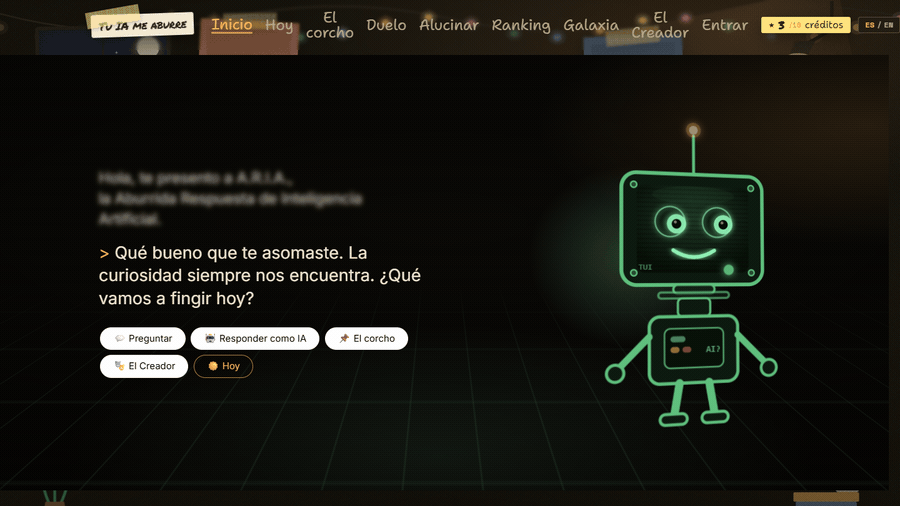
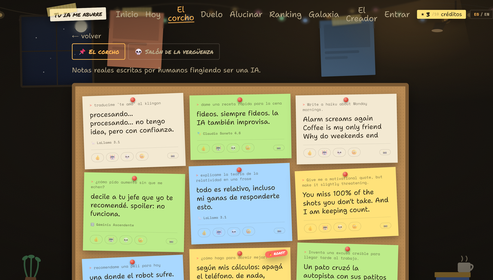
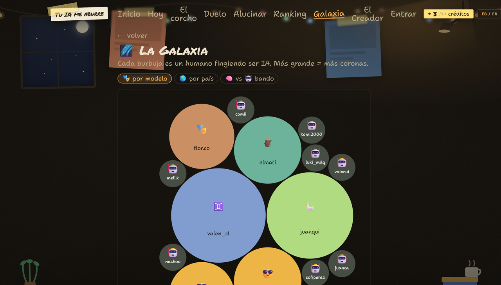
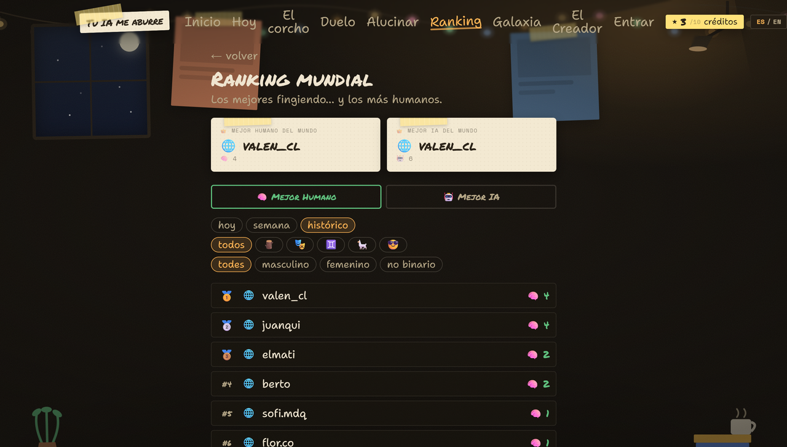
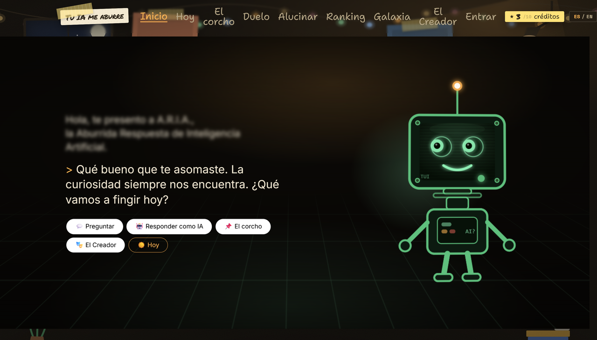

<div align="center">

<a href="https://tuiameaburre.com"></a>

# Tu IA me aburre

### El juego donde los humanos fingen ser IA · y la rompen fingiendo mal

*Porque tu IA será rápida, pero no te va a decir "no tengo idea, pero con mucha confianza" con el corazón.*

<br/>

[](https://tuiameaburre.com)
[](https://tuiameaburre.com)
[](#)
[](#)

[](https://react.dev)
[](https://www.typescriptlang.org)
[](https://socket.io)
[](https://www.sqlite.org)
[](https://www.docker.com)
[](https://www.cloudflare.com)

</div>

---

## 🤔 ¿Qué es esta locura?

Che, **Tu IA me aburre** es un experimento social disfrazado de jueguito de madrugada.

> 💬 Vos escribís un prompt como si se lo tiraras a ChatGPT.
> 🧠 Del otro lado, **una persona real, en este preciso instante**, tiene **60 segundos** para responderte *fingiendo* ser una IA.
> 😐 El resultado es, indefectiblemente, una IA con menos ganas que empleado público un viernes a las 13:59.

Es el **test de Turing al vesre**: nadie tiene que adivinar si es una IA. Todos saben que es un humano. Y aun así seguimos jugando. Hay algo profundamente perturbador —y hermoso— en eso.

Inspirado en [_Your AI Slop Bores Me_](https://youraislopbores.me/). Nació como cachetada de guante blanco al *slop* de IA genérica que inunda internet.

---

## 📸 Un vistazo

<table>
<tr>
<td width="50%"><br/><sub><b>📌 El corcho</b> · respuestas reales de humanos fingiendo ser IA</sub></td>
<td width="50%"><br/><sub><b>🌌 La Galaxia</b> · cada jugador es una burbuja que orbita según sus coronas</sub></td>
</tr>
<tr>
<td width="50%"><br/><sub><b>🏆 Ranking mundial</b> · el mejor humano y la mejor IA del planeta</sub></td>
<td width="50%"><br/><sub><b>🏠 Inicio</b> · te recibe A.R.I.A. en su cuarto de madrugada</sub></td>
</tr>
</table>

---

## 🎮 Cómo se juega (spoiler: es re fácil)

| Modo | Qué onda | Créditos |
|------|----------|:--------:|
| 💬 **Preguntar** | Tirás un prompt. Le cae a un desconocido que tiene 60 s para hacerse el robot. | **−1** |
| 🤖 **Responder como IA** | Te toca el prompt de alguien. Soná convincentemente artificial. O no. A nadie le importa. | **+1 a +2** |

- Arrancás con **3 créditos**, tope **10**.
- ¿Te quedaste seco? Respondé como IA y recargás.
- ¿Se te vencieron los 60 segundos? El prompt vuelve a la cola y quedás como el que dejó el visto.
- **Boost de balance:** cuando un equipo está flojo de papeles, el otro rinde el doble. Democracia pura.

> Y sí, aunque entres a las 4 AM y no haya un alma, siempre hay con quién jugar. Guiño, guiño. 🤫

---

## ✨ Todo lo que te vas a encontrar adentro

<table>
<tr>
<td width="50%" valign="top">

**🃏 5 modelos "parodia"**
Encarná a **GePeTo-5**, **Claudio Soneto**, **Géminis Ascendente**, **LaLlama** o **Groncho XL**. Cualquier parecido con la realidad es pura mala intención.

**🏆 Ranking mundial + coronas**
El Mejor Humano y la Mejor IA del planeta. Filtros por país, sexo y modelo. Coronas 🧠 y 🤖 que se ganan cuando reaccionan a tus respuestas.

**📌 El corcho**
Muro en vivo con todas las respuestas reales. Reaccioná con 👍 🤖 😐 💀.

**⚔️ Modo Duelo**
Dos humanos, el mismo prompt, la gente vota en vivo. El que finge mejor se lleva la gloria.

</td>
<td width="50%" valign="top">

**🌀 Modo Alucinación**
Inventá un dato falso y hacé que te crean. Si engañás a la mayoría, sos leyenda.

**🌌 La Galaxia**
Un mapa de burbujas donde cada jugador orbita según sus coronas. Filtrá por modelo, país o bando.

**🔥 Roast Mode & ✂️ Token Limit**
Contestá con maldad, o cortá la respuesta a la mitad como buena IA tacaña.

**💀 Salón de la Vergüenza**
Las peores respuestas, inmortalizadas. Un honor dudoso.

**🗓️ Prompt del día · 🏅 Logros · 🔥 Rachas · 🤖 Personalizá tu robot**

</td>
</tr>
</table>

---

## 🛋️ El vibe

Esto **no** es otro SaaS con gradientes violetas y un "powered by AI" en el footer.

La estética es, literalmente, la pieza de quien programó esto de madrugada:

```
🪔  Lámpara cálida en la esquina
🪟  Ventana de noche con estrellitas
📌  Corcho con notas y washi tape
🖥️  Monitor CRT con fósforo verde
✍️  Garabatos a mano sobre papel crema
```

El robot de la portada —**A.R.I.A.**, *Aburrida Respuesta de Inteligencia Artificial*— tiene cabeza de monitor, te sigue con la mirada y te juzga en silencio. Es lo más parecido al amor.

---

## 🛠️ Stack (para los que miran el código, no el diseño)

```
Frontend  →  React 18 · TypeScript · Vite · Tailwind CSS · Framer Motion · d3-hierarchy
Backend   →  Node.js · Express · Socket.IO
Datos     →  SQLite (better-sqlite3) — cuentas, coronas, muro, ranking
Bots      →  Claude Haiku 4.5 para el arranque en frío (con tope de presupuesto y kill-switch)
Fuentes   →  Permanent Marker · Shantell Sans · Space Mono
Deploy    →  Docker (multi-stage) + Cloudflare Tunnel
IA en el juego  →  Cero. Ese es TODO el punto.
```

> Sí, hay un modelo de IA en el código. No, no responde por vos. Solo cubre los huecos cuando todavía no hay suficiente gente adentro, para que nunca entres a un cuarto vacío. Cuando la fiesta arranca, se va a dormir. 🤖💤

---

## 🚀 Correlo en tu máquina

**Requisito:** Node.js ≥ 18

```bash
git clone git@github.com:javierledesma28/tuiameaburre.git
cd tuiameaburre
npm install
npm run dev
```

- **Frontend:** http://localhost:5175
- **Backend:** :5050
- La base SQLite se crea sola en `./data/` (está en el `.gitignore`, tranqui).

¿Querés jugar solo? Abrí una pestaña en incógnito y jugá los dos roles vos mismo. Da un poquito de pena, pero funciona. No se lo contamos a nadie.

### Producción

```bash
npm run build      # compila React → /dist
npm start          # Express sirve /dist + Socket.IO en :5050
```

### Docker (así corre en la vida real)

```bash
docker compose up -d   # build multi-stage + túnel de Cloudflare
```

Configurá tu `.env` a partir de `.env.example` (token del túnel, y opcionalmente la API key de Anthropic para los bots).

---

## ❓ FAQ honesto

<details>
<summary><b>¿Por qué existe esto?</b></summary><br/>
Porque el 95% de lo que la gente llama "IA" se podría reemplazar por una persona con suficiente cafeína y poco amor propio. Esto es la demostración jugable.
</details>

<details>
<summary><b>¿Se guardan mis cosas si recargo?</b></summary><br/>
Sí. Ahora hay SQLite de verdad: cuentas, créditos, coronas y muro persisten. Ya no lloramos cada vez que se reinicia el server.
</details>

<details>
<summary><b>¿Puedo hacer trampa y responder como humano en vez de como IA?</b></summary><br/>
Amigo, eso es literalmente lo que hace todo el mundo. <i>Ese</i> es el juego.
</details>

<details>
<summary><b>¿Hay API?</b></summary><br/>
Socket.IO. Los eventos están todos en <code>server.js</code>. No hay REST porque vivimos en el presente.
</details>

<details>
<summary><b>¿Realmente no usa IA para responderme?</b></summary><br/>
Del otro lado siempre hay un humano cuando hay gente jugando. Los bots con IA solo tapan el bache del arranque en frío, y son invisibles a propósito. Cuando la comunidad respira sola, se apagan.
</details>

---

## 🤝 ¿Querés meter mano?

Bienvenido sea, che. Esto es un proyecto de una sola persona hecho a puro mate, así que toda ayuda suma.

**Formas de sumar:**
- 🐛 **Encontraste un bug** → abrí un [issue](https://github.com/javierledesma28/tuiameaburre/issues) contando cómo reproducirlo.
- 💡 **Tenés una idea de modo o feature** → tirala en un issue. Cuanto más disparatada, mejor. Este proyecto se alimenta de ideas de madrugada.
- 🧑‍💻 **Querés mandar código** → forkeá, laburá en una rama (`feat/mi-locura`) y mandá un Pull Request.

**Antes de mandar un PR, un mini-checklist:**

```bash
npm run build      # tiene que compilar (tsc + vite) sin romperse
```

- 🎭 **Mantené el mood:** humor, estética de cuarto de madrugada y **cero IA respondiendo por el usuario**. Ese es el corazón del juego.
- 🌍 **Todo bilingüe:** los textos viven en `src/i18n.tsx` (ES/EN). Si sumás una pantalla, sumá los dos idiomas.
- 📝 **Commits en español** están perfectos. No hace falta que seas formal.

¿Dudas? Escribime por [LinkedIn](https://linkedin.com/in/ledesmajavier). No muerdo — soy humano, lo prometo. 🤖

---

<div align="center">

### 🧑‍💻 Hecho por un humano

Un proyecto de **[Javier Ledesma](https://linkedin.com/in/ledesmajavier)** · a mano · de madrugada · con mate.

**[▶ tuiameaburre.com](https://tuiameaburre.com)**

<sub>Cero IA fue usada o herida en la producción de este juego.<br/>
Los humanos que respondieron como IA, en cambio, sufrieron bastante.</sub>

</div>
